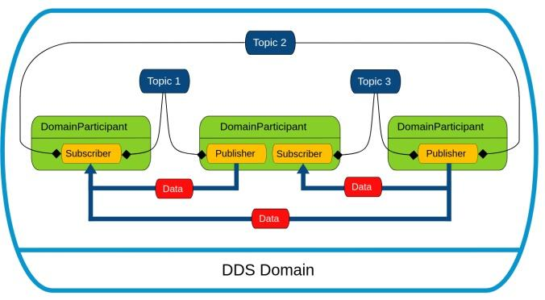
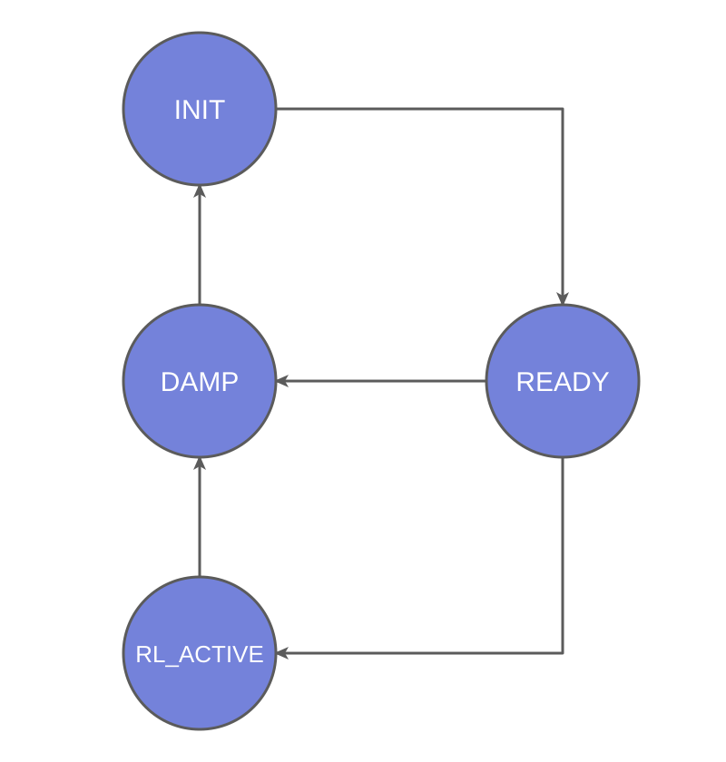

# Application Development

[中文](README.md) | [English](README_EN.md)

## **SDK Overview**

Zvalley Robot SDK is a high-performance robot control software development kit based on DDS (Data Distribution Service). It provides standardized communication and control interfaces for robotic systems. The SDK uses a modern C++ architecture and supports ROS2-compatible data formats.

## **Getting the SDK**

### Introduction

Zvalley Robot SDK is a development kit from Zvalley for next-generation robots. It provides a unified interface for low-level motor control and high-level motion control. Standardized interfaces and example projects help developers extend robot functionality and build custom applications. With Zvalley Robot SDK, developers can efficiently build mobile platforms, control algorithms, and application systems.

### SDK Repository

https://github.com/Zvalley-Robotics/zv_robot_sdk.git

Follow the repository README to install the SDK on your development computer.

## Quick Start

### System Requirements

| Hardware | Recommended Configuration |
| :------- | :------------------------ |
| OS | Ubuntu 22.04 LTS |
| CPU | x86_64 / ARM64 |
| CPU Cores | 4 |
| RAM | 16 GB |

The SDK includes MCAP reading support. Install the LZ4 and Zstd runtime libraries to use data collection:

```bash
sudo apt-get install liblz4-1 libzstd1
```

### Using the SDK

To build your own application with the SDK, create an example program in the examples directory, compile it, and run the resulting executable to verify its functionality.

```
cd examples
mkdir build && cd build
cmake ..
make
```

After compilation, executables are generated in the `build` directory and can be run directly.

High-level service operations also require the corresponding services on the robot to be online.

# Services

Zvalley Robot SDK provides both **high-level services** and **low-level services**, using different communication patterns to meet their respective real-time requirements. High-level services control overall robot behavior, such as mode switching, omnidirectional movement, composite actions, and head control. These commands use RPC request/response calls, which suit one-time or low-frequency operations. Low-level services handle real-time data and low-level control, including high-frequency motor and IMU data acquisition and direct motor control. These interfaces use DDS publish/subscribe communication for continuous, high-speed data exchange.

## High-Level Service Interfaces

### DDS Communication Interfaces

#### **Introduction to Cyclone DDS**

DDS is a distributed communication framework that implements the OMG DDS specification. Publish/subscribe communication allows nodes to exchange data directly without a central server, while QoS policies provide reliability and real-time behavior.



#### Interface Reference

`zv::robot` provides DDS communication for sending and receiving messages within a robotic system or between the robot and external applications. The main classes are `ChannelFactory`, `ChannelPublisher`, and `ChannelSubscriber`.

---

**zv:: robot::ChannelFactory**

ChannelFactory is a singleton used to create channels based on DDS topics. Call its initialization interface before use to configure the underlying DDS communication.

| Function | Instance |
|-----------|------|
| Prototype | static zv:: robot::ChannelFactory* zv:: robot::ChannelFactory::Instance() |
| Description | Returns a pointer to the singleton instance |
| Parameters | None |
| Returns | Pointer to the zv::robot::ChannelFactory singleton |
| Notes | None |

| Function | Release |
|-----------|------|
| Prototype | void Release() |
| Description | Releases ChannelFactory static resources |
| Parameters | None |
| Returns | None |
| Notes | zv::robot::ChannelFactory::Instance()->Release() |

| Function | Init |
|-----------|------|
| Prototype | void Init(const nlohmann::json &config) |
| Description | Initializes the factory and its internal DDS factory from the configuration |
| Parameters | config: JSON configuration required for initialization |
| Returns | None |
| Notes | None |

| Function | Init |
|-----------|------|
| Prototype | void Init(int32_t domainId, const std::string& networkInterface = "") |
| Description | Initializes ChannelFactory with a domain ID and network interface |
| Parameters | domainId: domain ID used to construct the default DdsParticipant; networkInterface: network interface name, empty by default |
| Returns | None |
| Notes | If networkInterface is empty, a default configuration with automatic interface selection is generated; set enableSharedMemory to false when developing external applications |

| Function | CreateSendChannel |
|-----------|------|
| Prototype | Channel pointer CreateSendChannel(const std::string& name) |
| Description | Creates a sending channel with the specified name and message type MSG |
| Parameters | name: channel name |
| Returns | Pointer to the templated channel |
| Notes | None |

| Function | CreateRecvChannel |
|-----------|------|
| Prototype | Channel pointer CreateRecvChannel(const std::string& name, std::function<void(const void*)> callback, int32_t queuelen = 0) |
| Description | Creates a receiving channel with the specified name and message type MSG |
| Parameters | name: channel name; callback: callback invoked when a message arrives; queuelen: message queue length; 0 disables the queue |
| Returns | Pointer to the templated channel |
| Notes | For callbacks that perform thousands of processing operations, enable the message queue to avoid blocking the DDS callback thread |

---

**zv:: robot::ChannelPublisher**

Publishes messages of a specified type.

| Class | Constructor and Destructor |
|-----------|------|
| template ChannelPublisher | explicit ChannelPublisher(const std::string& channelName); ~ChannelPublisher() |

| Function | InitChannel |
|-----------|------|
| Prototype | void InitChannel() |
| Description | Initializes the channel for publishing messages |
| Parameters | None |
| Returns | None |
| Notes | None |

| Function | CloseChannel |
|-----------|------|
| Prototype | void CloseChannel() |
| Description | Closes the channel |
| Parameters | None |
| Returns | None |
| Notes | None |

| Function | Write |
|-----------|------|
| Prototype | bool Write(const MSG& msg,int64_t wait_microsec =0) |
| Description | Publishes a message of the specified type |
| Parameters | msg: message of type MSG to publish |
| Returns | true on success; false on failure |
| Notes | None |

**DDS Publishing Example — Hello World**

Example: `examples/helloworld/publisher.cpp`

This example uses the SDK's ChannelPublisher API to publish a simple string message.

```cpp
#include <unistd.h>

#include <zv/robot/channel/channel_publisher.hpp>

#include "String_.hpp"

// Topic to publish to
static const std::string HELLO_WORLD_TOPIC = "rt/hello_world";

using namespace zv::robot;
using namespace zv::common;

int main()
{
    // Initialize the channel factory once per process
    ChannelFactory::Instance()->Init(0);

    // Create and initialize the publisher
    ChannelPublisher<std_msgs::msg::dds_::String_> publisher(HELLO_WORLD_TOPIC);
    publisher.InitChannel();
    int count = 0;
    while (true) {
        // Construct a message and write it to the channel
        std_msgs::msg::dds_::String_ msg("HelloWorld. " + std::to_string(count++));
        publisher.Write(msg);
        // Publish at 1 Hz
        sleep(1);
    }
    return 0;
}
```

---

**zv:: robot::ChannelSubscriber**

Subscribes to messages of a specified type.

| Class | Constructor and Destructor |
|-----------|------|
| template ChannelSubscriber | explicit ChannelSubscriber(const std::string& channelName); ~ChannelSubscriber() |

| Function | InitChannel |
|-----------|------|
| Prototype | void InitChannel(const std::function<void(const void*)>& handler, int64_t queuelen = 0) |
| Description | Initializes the channel to receive and process messages |
| Parameters | callback: callback invoked when a message arrives; queuelen: message queue length; 0 disables the queue |
| Returns | None |
| Notes | Enable the message queue for time-consuming callbacks to avoid blocking the DDS callback thread |

| Function | CloseChannel |
|-----------|------|
| Prototype | void CloseChannel() |
| Description | Closes the channel |
| Parameters | None |
| Returns | None |
| Notes | None |

| Function | GetLastDataAvailableTime |
|-----------|------|
| Prototype | int64_t GetLastDataAvailableTime() |
| Description | Returns the time the most recent message was received |
| Parameters | None |
| Returns | -1 if the channel is uninitialized; otherwise, a monotonically increasing timestamp since system boot, in microseconds |
| Notes | None |

**DDS Subscription Example — Hello World**

Example: `examples/helloworld/subscriber.cpp`

This example uses the SDK's ChannelSubscriber API to subscribe to string messages and read their contents in a callback.

```cpp
#include <iostream>
#include <zv/robot/channel/channel_subscriber.hpp>

#include "String_.hpp"

// Topic to subscribe to
static const std::string HELLO_WORLD_TOPIC = "rt/chatter";

using namespace zv::robot;
using namespace zv::common;

// 1. The SDK invokes this callback when a message arrives on the topic
void Handler(const void * msg)
{
    // Cast the generic pointer to the specific String_ message type
    const std_msgs::msg::dds_::String_ * hello_world_msg = (const std_msgs::msg::dds_::String_ *)msg;

    // Print the received message
    std::cout << "message:" << hello_world_msg->data_() << std::endl;
}

int main()
{
    // 2. Initialize the channel factory to manage underlying SDK communication resources
    ChannelFactory::Instance()->Init(0);

    // 3. Create a subscriber for the topic and message type
    ChannelSubscriber<std_msgs::msg::dds_::String_> subscriber(HELLO_WORLD_TOPIC);

    // 4. Initialize the channel and register Handler to process incoming messages
    subscriber.InitChannel(Handler);

    // 5. Keep the process running; the subscriber invokes the callback on an internal thread
    while (true) {
        std::this_thread::sleep_for(std::chrono::seconds(10));
    }
    return 0;
}
```

---

<div style="page-break-after: always;"></div>

## High-Level Motion Control Interfaces

#### Overall Design



The diagram shows only the main states and transition directions. Check `/robot/state` for the actual state.

#### Control Interface Reference

**1. /robot/input/intent Motion Control Interface**

Sends unified control intents to the robot, including state switching, action model switching, action pause/resume, and continuous motion control.

**Topic**

```
/robot/input/intent
```

**Message Type**

```RobotIntent.msg
std_msgs/Header header
string source
string intent_type
string command
string action
float32 linear_x_mps
float32 linear_y_mps
float32 angular_z_radps
uint8 priority
```

**Parameters**

| Parameter | Type | Description |
| --------- | ---- | ----------- |
| header | std_msgs/Header | Standard message header; stamp is used to determine whether the intent has expired |
| source | string | Intent source; use `sdk` |
| intent_type | string | Intent type: `status`, `motion`, `mode`, `model`, `config`, or `reset` |
| command | string | Specific command, such as `ready`, `walk`, `switch_model`, or `speed` |
| action | string | Command target or parameter; model name for model, `rl`/`rule` for mode, and a configuration value for config |
| linear_x_mps | float32 | Desired forward velocity (m/s) |
| linear_y_mps | float32 | Desired lateral velocity (m/s) |
| angular_z_radps | float32 | Desired yaw angular velocity (rad/s) |
| priority | uint8 | Intent priority; use `50` |

**intent_type and command Combinations**

| intent_type | command | action | Description |
| ----------- | ------- | ------ | ----------- |
| status | `ready`/`walk`/`damp`/`reinit` | — | Switch motion state |
| motion | `walk` | — | Send continuous motion velocities through `linear_x_mps`/`linear_y_mps`/`angular_z_radps` |
| model | `switch_model` | Model name | Switch action model |
| model | `motion_stop` | `stop` | Pause execution of the current action (model) |
| model | `motion_stop` | `resume` | Resume execution of the current action (model) |

**status Values**

| Value | Description |
| ----- | ----------- |
| ready | Ready state |
| walk | Walking control |
| damp | Damping state |
| reinit | Reinitialize |

**model Parameters**

Switches robot action models and pauses or resumes execution of the current action (model).

Available models:

| Model | Description |
| ----- | ----------- |
| z01_std_walk | Walking |
| z01_pa_walk | Walking |
| t4_walk | Walking |
| t4_sprint | Fast walking |
| t4_depth | Vision-guided walking |
| t4_heart | Heart gesture |
| t4_salute | Salute |
| t4_hello | Wave |
| t4_introduce | Self-introduction |
| t4_introduce_left | Self-introduction (left) |
| t4_introduce_right | Self-introduction (right) |
| t4_high_five | High five |
| t4_zl1 | Exhibition 1 |
| t4_zl2 | Exhibition 2 |
| t4_zl3 | Exhibition 3 |
| t4_zl4 | Exhibition 4 |
| t4_zl5 | Exhibition 5 |
| t4_zl6 | Exhibition 6 |
| t4_standby | Standby |
| t4_clap | Clap |
| t4_handshake | Handshake |
| t4_rhello | Right-hand wave |
| t4_rintroduce_left | Self-introduction (left, continuous) |
| t4_rintroduce_right | Self-introduction (right, continuous) |
| t4_yb1 | Welcome 1 |
| t4_yb2 | Welcome 2 |
| t4_yb2_left | Welcome 2 (left) |
| t4_yb3 | Welcome 3 |
| t4_yb3_left | Welcome 3 (left) |
| t4_yb4 | Welcome 4 |
| t4_taichi | Tai chi in motion |
| t4_taichi_w | Static tai chi |
| t4_mj_dance | Moonwalk dance |
| t4_xqxa123_dance | Xiang Qin Xiang Ai dance |
| t4_apt | APT dance |
| t4_rhythm | Rhythm dance |

**motion Parameters**

`motion` is a continuous motion command. A continuous publishing rate of 10 Hz is recommended. To stop, send an intent with all three velocities set to `0`.

| Parameter | Type | Description |
| --------- | ---- | ----------- |
| linear_x_mps | float32 | Forward/backward linear velocity (m/s); positive values move forward |
| linear_y_mps | float32 | Lateral linear velocity (m/s); positive values move left |
| angular_z_radps | float32 | Angular velocity (rad/s); positive values turn left |

**2. /robot/state Status Interface**

Reports the robot's current system state, active mode, active model, and fault information.

**Topic**

```
/robot/state
```

**Message Type**

```RobotState.msg
std_msgs/Header header
uint8 state
string state_name
string active_mode
string active_control_source
string active_rl_model
bool fault_active
string fault_reason
```

**Parameters**

| Parameter | Type | Description |
| --------- | ---- | ----------- |
| header | std_msgs/Header | Standard message header; stamp is the time the status was generated |
| state | uint8 | Current system state, represented by a `STATE_*` constant |
| state_name | string | State name, such as `READY` or `RL_ACTIVE` |
| active_mode | string | Current active mode, such as `idle`, `rl`, `rule`, or `debug` |
| active_control_source | string | Source currently holding control, such as `teleop`, `api`, or `rl_manager` |
| active_rl_model | string | Name of the active RL model; may be empty outside RL mode |
| fault_active | bool | Whether the robot is currently in a fault state |
| fault_reason | string | Main current fault reason; may be empty when there is no fault |

**state Values**

| Value | Description |
| ----- | ----------- |
| STATE_BOOTING (0) | Booting |
| STATE_INIT (1) | Initializing |
| STATE_IDLE (2) | Idle |
| STATE_DO_READY (3) | Preparing to enter the ready state |
| STATE_READY (4) | Ready |
| STATE_RL_STANDBY (5) | RL standby |
| STATE_RL_ACTIVE (6) | RL active |
| STATE_RULE_STANDBY (7) | Rule-based control standby |
| STATE_RULE_ACTIVE (8) | Rule-based control active |
| STATE_TRANSITIONING (9) | Transitioning |
| STATE_FAULT (10) | Fault |
| STATE_DAMP (11) | Damping |
| STATE_SHUTDOWN (12) | Shutdown |

**3. RobotIntent Publishing Example**

Example: `examples/highcmd/intent_publisher.cpp`

This example uses the SDK's `ChannelPublisher` to publish `RobotIntent_` messages, performing state switching, model switching, and continuous motion control in sequence.

```cpp
#include <unistd.h>

#include <zv/robot/channel/channel_publisher.hpp>

#include "RobotIntent_.hpp"

static const std::string INTENT_TOPIC = "rt/robot/input/intent";

using namespace zv::robot;
using namespace zv::common;

int main()
{
    // 1. Initialize the channel factory once per process
    ChannelFactory::Instance()->Init(0);

    // 2. Create and initialize the RobotIntent publisher
    ChannelPublisher<robot_interfaces::msg::dds_::RobotIntent_> publisher(INTENT_TOPIC);
    publisher.InitChannel();

    // 3. Switch to ready: intent_type=status, command=ready
    robot_interfaces::msg::dds_::RobotIntent_ intent;
    intent.source_("sdk");
    intent.priority_(50);
    intent.intent_type_("status");
    intent.command_("ready");
    publisher.Write(intent);
    sleep(2);

    // 4. Switch action model: intent_type=model, command=switch_model, action=walk
    intent.intent_type_("model");
    intent.command_("switch_model");
    intent.action_("walk");
    publisher.Write(intent);
    sleep(2);

    // 5. Move forward at 0.3 m/s: intent_type=motion, command=walk, published at approximately 20 Hz
    intent.intent_type_("motion");
    intent.command_("walk");
    intent.action_("");
    intent.linear_x_mps_(0.3F);
    intent.linear_y_mps_(0.0F);
    intent.angular_z_radps_(0.0F);
    for (int i = 0; i < 200; ++i) {
        publisher.Write(intent);
        usleep(50000);
    }

    // 6. Stop by sending zero velocities
    intent.linear_x_mps_(0.0F);
    intent.linear_y_mps_(0.0F);
    intent.angular_z_radps_(0.0F);
    publisher.Write(intent);
    return 0;
}
```

**4. RobotState Subscription Example**

Example: `examples/highcmd/state_subscriber.cpp`

This example uses the SDK's `ChannelSubscriber` to subscribe to `RobotState_` messages and read the robot's current state, active mode, and model.

```cpp
#include <unistd.h>

#include <iostream>
#include <zv/robot/channel/channel_subscriber.hpp>

#include "RobotState_.hpp"

static const std::string STATE_TOPIC = "rt/robot/state";
// Bridge configuration: reliability=best_effort, history=keep_last, depth=5.
static constexpr int64_t STATE_QUEUE_LEN = 5;
static constexpr bool STATE_RELIABLE = false;

using namespace zv::robot;
using namespace zv::common;

// 1. The SDK invokes this callback when a RobotState_ message arrives on the topic
void Handler(const void * msg)
{
    const auto * state = static_cast<const robot_interfaces::msg::dds_::RobotState_ *>(msg);

    // 2. Read and print the state fields
    std::cout << "state: " << static_cast<int>(state->state_()) << ", state_name: " << state->state_name_()
              << ", active_mode: " << state->active_mode_() << ", active_rl_model: " << state->active_rl_model_()
              << std::endl;
}

int main()
{
    // 3. Initialize the channel factory
    ChannelFactory::Instance()->Init(0);

    // 4. Create a subscriber for the topic and message type
    ChannelSubscriber<robot_interfaces::msg::dds_::RobotState_> subscriber(STATE_TOPIC);

    // 5. Initialize the channel and register the callback with QoS matching robot_external_bridge
    subscriber.InitChannel(Handler, STATE_QUEUE_LEN, STATE_RELIABLE);

    // 6. Keep the process running; the subscriber receives messages and invokes Handler on an internal thread
    while (true) {
        sleep(10);
    }
    return 0;
}
```

## Data Collection Interface

`zv::robot::DataCollectionClient` starts and stops data recording on the robot.
Initialize DDS communication before use and ensure that data collection and the corresponding RPC services on the robot are online.

| Interface | Description |
| --------- | ----------- |
| `StartRecording()` | Starts recording |
| `StopRecording(RecordingInfo& recording)` | Stops recording and returns recording file information and the message count |

An interface return value of `0` indicates success; any nonzero value indicates failure. Use `GetLastErrorMessage()` for error details.
`StopRecording()` only stops recording and returns file information; it does not download the file automatically.

**Start/Stop Recording Example**

```cpp
#include <iostream>
#include <zv/robot/channel/channel_factory.hpp>
#include <zv/robot/data_collection/data_collection_client.hpp>

int main()
{
    // 1. Initialize communication and the data collection client; set the domain ID and interface for your environment
    zv::robot::ChannelFactory::Instance()->Init(0);
    zv::robot::DataCollectionClient client;
    client.Init();
    client.SetTimeout(30.0f);

    // 2. Start recording
    int32_t result = client.StartRecording();
    if (result != 0) {
        std::cerr << "Failed to start recording, code=" << result << ": " << client.GetLastErrorMessage() << '\n';
        return 1;
    }
    std::cout << "Recording started. Press Enter to stop." << std::endl;
    std::cin.get();

    // 3. Stop recording and retrieve file information from the robot
    zv::robot::RecordingInfo recording;
    result = client.StopRecording(recording);
    if (result != 0) {
        std::cerr << "Failed to stop recording, code=" << result << ": " << client.GetLastErrorMessage() << '\n';
        return 1;
    }
    std::cout << "File name: " << recording.file.name << "\nRemote path: " << recording.file.path
              << "\nFile size (bytes): " << recording.file.size << "\nMessage count: " << recording.message_count << '\n';
    return 0;
}
```

For recording file downloads and MCAP reading and parsing, see
[examples/data_collection/data_collection.cpp](examples/data_collection/data_collection.cpp).
`DownloadRecording()` demonstrates downloading a file, while `ReadMcapFile()` demonstrates reading messages one by one
and using `McapMessage::DecodeJson()` to preview application fields.

## Low-Level Service Interfaces

Low-level communication exchanges data between the user's PC and the robot using DDS.

#### Interface Reference

Subscribe to or publish topics using the methods described in the DDS communication section. Topic data is stored in structures defined by IDL. Common structures include:

| Structure | Description |
| --------- | ----------- |
| JointState_ | Feedback for a single logical joint, including position, velocity, effort, motor temperature, error codes, and error descriptions |
| JointStates_ | Feedback frame for multiple joints, including a sequence number, correlation ID of the most recent command, and a joint state list |
| HeadControl_ | Head yaw and pitch angle commands, in degrees |
| Twist_ | Chassis velocity command, including linear velocity (m/s) and angular velocity (rad/s) |

**Low-Level DDS Command and State Feedback Examples**

Low-level DDS command example: examples/lowcmd/publisher.cpp

This example uses the SDK to publish head control (HeadControl) and chassis velocity (Twist) DDS messages to rt/robot/external/head_control and rt/cmd_vel, respectively. Head control messages contain target yaw and pitch angles and a relative/absolute angle flag. Chassis messages contain linear and angular velocities.

The example publishes at 1 Hz, with the head target defaulting to an absolute angle of 0° and the chassis velocity to zero. Head angles are in degrees; chassis linear velocity is in m/s and angular velocity is in rad/s. When interrupted with Ctrl+C or SIGTERM, it sends an additional zero-velocity message.

```cpp
#include <chrono>
#include <csignal>
#include <iostream>
#include <string>
#include <thread>
#include <zv/robot/channel/channel_publisher.hpp>

#include "HeadControl_.hpp"
#include "Twist_.hpp"

// DDS topic name = rt + absolute ROS2 path.
static const std::string HEAD_CONTROL_TOPIC = "rt/robot/external/head_control";
static const std::string CMD_VEL_TOPIC = "rt/cmd_vel";
static constexpr auto PUBLISH_PERIOD = std::chrono::seconds(1);

static volatile std::sig_atomic_t keep_running = 1;

static void HandleSignal(int) { keep_running = 0; }

using namespace zv::robot;

int main()
{
    std::signal(SIGINT, HandleSignal);
    std::signal(SIGTERM, HandleSignal);

    // 1. Initialize the channel factory for global communication resources
    ChannelFactory::Instance()->Init(0);

    // 2. Create publishers for the topics and message types
    ChannelPublisher<robot_interfaces::msg::dds_::HeadControl_> head_publisher(HEAD_CONTROL_TOPIC);
    ChannelPublisher<geometry_msgs::msg::dds_::Twist_> velocity_publisher(CMD_VEL_TOPIC);

    // 3. Initialize the communication channels
    head_publisher.InitChannel();
    velocity_publisher.InitChannel();

    // 4. Construct a HeadControl_ message and set the head control parameters
    // Adjust the target angles (degrees) as needed. Use absolute angles for continuous publishing to avoid accumulation.
    robot_interfaces::msg::dds_::HeadControl_ head;
    head.yaw_(0.0f);
    head.pitch_(0.0f);
    head.is_relative_(false);

    // 5. Construct a Twist_ message and set the chassis control parameters
    // Adjust the chassis velocities as needed: linear.x/y in m/s and angular.z in rad/s.
    // Leave all other components at zero.
    geometry_msgs::msg::dds_::Twist_ velocity;
    velocity.linear_().x_(0.0);
    velocity.linear_().y_(0.0);
    velocity.angular_().z_(0.0);

    std::cout << "Publishing " << HEAD_CONTROL_TOPIC << " and " << CMD_VEL_TOPIC << " at 1 Hz; press Ctrl+C to stop."
              << std::endl;

    auto next_publish_time = std::chrono::steady_clock::now();
    while (keep_running != 0) {
        // 6. Publish messages to the topics
        head_publisher.Write(head);
        velocity_publisher.Write(velocity);
        next_publish_time += PUBLISH_PERIOD;
        std::this_thread::sleep_until(next_publish_time);
    }

    velocity_publisher.Write(geometry_msgs::msg::dds_::Twist_{});
    std::cout << "Stopped; sent zero velocity." << std::endl;
    return 0;
}
```

Low-level DDS state feedback example: examples/lowcmd/subscriber.cpp

This example uses the SDK to subscribe to robot joint state (JointStates) DDS messages on rt/robot/driver/joint_states, corresponding to /robot/driver/joint_states in robot_external_bridge. The callback reads joint names, position, velocity, effort, and error information.

```cpp
#include <chrono>
#include <iostream>
#include <thread>
#include <zv/robot/channel/channel_subscriber.hpp>

#include "JointStates_.hpp"

// Topic for all robot joint states, corresponding to /robot/driver/joint_states
static const std::string LOW_STATE_TOPIC = "rt/robot/driver/joint_states";
// Bridge configuration: reliability=best_effort, history=keep_last, depth=5.
static constexpr int64_t LOW_STATE_QUEUE_LEN = 5;
static constexpr bool LOW_STATE_RELIABLE = false;

using namespace zv::robot;
using namespace zv::common;

// 1. The SDK invokes this callback when a JointStates_ message arrives on the topic
void Handler(const void * msg)
{
    // Cast the generic pointer to the specific JointStates_ message type
    const auto * joint_state_msg = static_cast<const robot_interfaces::msg::dds_::JointStates_ *>(msg);

    // Read the state frame sequence number and its correlation with the most recent command
    const uint32_t sequence = joint_state_msg->sequence_();
    const uint64_t last_command_trace_id = joint_state_msg->last_command_trace_id_();
    const uint32_t last_command_sequence = joint_state_msg->last_command_sequence_();
    const auto & joint_states = joint_state_msg->states_();

    // Print the state frame sequence number and command correlation information
    std::cout << "[Subscriber] Message received sequence: " << sequence
              << ", last command trace id: " << last_command_trace_id
              << ", last command sequence: " << last_command_sequence << std::endl;

    // Print all joint states; cast uint8_t to int to avoid printing it as a character
    for (size_t i = 0; i < joint_states.size(); i++) {
        const auto & js = joint_states[i];
        std::cout << "    joint " << i << " name: " << js.joint_name_() << ", position: " << js.position_()
                  << ", velocity: " << js.velocity_() << ", effort: " << js.effort_()
                  << ", motor_error: " << static_cast<int>(js.motor_error_())
                  << ", joint_error: " << static_cast<int>(js.joint_error_())
                  << ", error_message: " << js.error_message_() << std::endl;
    }
}

int main()
{
    // 2. Initialize the channel factory to manage underlying communication resources
    ChannelFactory::Instance()->Init(0);

    // 3. Create a subscriber for the topic and message type
    ChannelSubscriber<robot_interfaces::msg::dds_::JointStates_> subscriber(LOW_STATE_TOPIC);

    // 4. Initialize the channel and register the callback with QoS matching robot_external_bridge
    subscriber.InitChannel(Handler, LOW_STATE_QUEUE_LEN, LOW_STATE_RELIABLE);

    // 5. Keep the process running; the subscriber receives messages and invokes Handler on an internal thread
    while (true) {
        std::this_thread::sleep_for(std::chrono::seconds(10));
    }
    return 0;
}
```

**IMU / Navigation Data Subscription Example**

Example: examples/imu_nav/subscriber.cpp

This example uses the SDK to subscribe to IMU and integrated navigation data (NavAll_) on rt/robot/imu/nav_all, corresponding to /robot/imu/nav_all in robot_external_bridge. The callback reads acceleration, angular velocity, Euler angles, quaternion, GNSS longitude/latitude/altitude, east/north/up velocity, UTC time, fusion/GNSS status, temperature, and pressure.

```cpp
#include <chrono>
#include <iostream>
#include <thread>
#include <zv/robot/channel/channel_subscriber.hpp>

#include "NavAll_.hpp"

// Topic for IMU / integrated navigation data
static const std::string NAV_ALL_TOPIC = "rt/robot/imu/nav_all";

using namespace zv::robot;
using namespace zv::common;

// 1. The SDK invokes this callback when a NavAll_ message arrives on the topic
void Handler(const void * msg)
{
    // Cast the generic pointer to the specific NavAll_ message type
    const yesense_interface::msg::dds_::NavAll_ * nav_msg = (const yesense_interface::msg::dds_::NavAll_ *)msg;

    // Get references to the component structures
    const auto & acc = nav_msg->acc_();
    const auto & gyro = nav_msg->gyro_();
    const auto & euler = nav_msg->euler_();
    const auto & quat = nav_msg->quat_();
    const auto & pos = nav_msg->pos_();
    const auto & vel = nav_msg->vel_();
    const auto & status = nav_msg->status_();
    const auto & temp = nav_msg->temp_();
    const auto & pressure = nav_msg->pressure_();
    const auto & utc = nav_msg->utc_();
    uint16_t tid = nav_msg->tid_().tid_();

    // Cast uint8_t to int to avoid printing it as a character
    std::cout << "===== IMU NavAll =====" << std::endl;
    std::cout << "  tid: " << tid << std::endl;
    std::cout << "  acc  [x, y, z]: " << acc.x_() << ", " << acc.y_() << ", " << acc.z_() << std::endl;
    std::cout << "  gyro [x, y, z]: " << gyro.x_() << ", " << gyro.y_() << ", " << gyro.z_() << std::endl;
    std::cout << "  euler [pitch, roll, yaw]: " << euler.pitch_() << ", " << euler.roll_() << ", " << euler.yaw_()
              << std::endl;
    std::cout << "  quat [q0, q1, q2, q3]: " << quat.q0_() << ", " << quat.q1_() << ", " << quat.q2_() << ", "
              << quat.q3_() << std::endl;
    std::cout << "  gnss [lon, lat, alt]: " << pos.longitude_() << ", " << pos.latitude_() << ", " << pos.altitude_()
              << std::endl;
    std::cout << "  vel  [e, n, u]: " << vel.vel_e_() << ", " << vel.vel_n_() << ", " << vel.vel_u_() << std::endl;
    std::cout << "  utc  [" << static_cast<int>(utc.year_()) << "-" << static_cast<int>(utc.month_()) << "-"
              << static_cast<int>(utc.day_()) << " " << static_cast<int>(utc.hour_()) << ":"
              << static_cast<int>(utc.min_()) << ":" << static_cast<int>(utc.sec_()) << "." << utc.ms_() << "]"
              << std::endl;
    std::cout << "  status [fusion, gnss]: " << static_cast<int>(status.fusion_status_()) << ", "
              << static_cast<int>(status.gnss_status_()) << std::endl;
    std::cout << "  temp: " << temp.temp_() << std::endl;
    std::cout << "  pressure: " << pressure.val_() << std::endl;
}

int main()
{
    // 2. Initialize the channel factory to manage underlying communication resources
    ChannelFactory::Instance()->Init(0);

    // 3. Create a subscriber for the topic and message type
    ChannelSubscriber<yesense_interface::msg::dds_::NavAll_> subscriber(NAV_ALL_TOPIC);

    // 4. Initialize the channel and register the callback
    subscriber.InitChannel(Handler);

    // 5. Keep the process running; the subscriber receives messages and invokes Handler on an internal thread
    while (true) {
        std::this_thread::sleep_for(std::chrono::seconds(10));
    }

    return 0;
}
```

> This example corresponds to the `imuNavSubscriber` build target in `examples/CMakeLists.txt`, which produces the `imuNavSubscriber` executable.

**DDS Camera Preview Example**

Example: examples/camera/subscriber.cpp

`CameraSubscriber` subscribes to compressed images from the head camera and retrieves the latest frame without blocking through `TakeFrame()`.
Before running it, ensure that the camera driver is publishing images and set the topic, network interface, and domain ID for your environment.

```cpp
#include <unistd.h>

#include <iostream>
#include <map>
#include <zv/robot/media/camera_subscriber.hpp>

int main()
{
    // 1. Map camera names to complete DDS topic names
    const std::map<std::string, std::string> topics{
        {"head", "rt/media/camera/head/color/image_raw/compressed"}
    };

    // 2. Create and initialize CameraSubscriber with the camera names and topics
    zv::robot::CameraSubscriber subscriber;
    subscriber.Init(0, "", topics);

    // 3. Continuously poll the latest compressed image from each camera
    zv::robot::CameraFrame frame;
    while (true) {
        for (const auto & [name, topic] : topics) {
            // TakeFrame returns without blocking and indicates whether a new frame is available for this camera.
            if (subscriber.TakeFrame(name, frame)) {
                // 4. Print the camera name, frame ID, compression format, and data length
                std::cout << name << ": " << frame.frame_id << ", " << frame.format << ", " << frame.data.size()
                          << " bytes" << std::endl;
            }
        }
        // 5. Poll every 100 ms to avoid consuming CPU in an empty polling loop
        usleep(100000);
    }

    return 0;
}
```

#### Message Types

The following message types are in the `robot_interfaces::msg::dds_` namespace. Field names retain the trailing `_` generated by DDS.

**Single Joint State (JointState_)**

| Field | Type | Description |
| ----- | ---- | ----------- |
| **joint_name_** | std::string | Joint name |
| **position_** | float | Current position (rad or m) |
| **velocity_** | float | Current velocity (rad/s or m/s) |
| **effort_** | float | Current torque/force (Nm or N) |
| **motor_temp_** | float | Motor temperature (degrees Celsius); 0 if unavailable |
| **mos_temp_** | float | MOS temperature (degrees Celsius) |
| **motor_error_** | uint8_t | Low-level motor drive fault code read directly from Encos/EtherCAT |
| **enabled_** | bool | Whether the joint is currently enabled |
| **joint_error_** | uint8_t | Joint error code, represented by a `JOINT_ERR_*` constant |
| **error_message_** | std::string | Human-readable error description; may be empty when there is no error |

`joint_error_` values (`JointState_Constants`):

| Constant | Value | Meaning |
| -------- | ----- | ------- |
| **JOINT_ERR_NONE_** | 0 | Joint operating normally |
| **JOINT_ERR_MOTOR_WARN_** | 1 | Low-level motor or drive warning |
| **JOINT_ERR_INVALID_ANGLE_STATE_** | 2 | Invalid feedback angle/position |
| **JOINT_ERR_INVALID_ANGLE_CMD_** | 3 | Invalid target angle/position command |
| **JOINT_ERR_ZERO_ABSENCE_** | 4 | Missing zero reference or abnormal zero-reference state |

**Multiple Joint State Frame (JointStates_)**

| Field | Type | Description |
| ----- | ---- | ----------- |
| **header_** | std_msgs::msg::dds_::Header_ | Standard message header; stamp is the time the feedback was generated |
| **sequence_** | uint32_t | State frame sequence number for detecting lost, out-of-order, or duplicate frames |
| **last_command_trace_id_** | uint64_t | trace_id of the most recently received/applied command |
| **last_command_sequence_** | uint32_t | Frame sequence number of the most recently received/applied command |
| **states_** | std::vector<JointState_> | Joint state list; the order in the robot configuration is recommended |

**Unified High-Level Control Intent (RobotIntent_)**

| Field | Type | Description |
| ----- | ---- | ----------- |
| **header_** | std_msgs::msg::dds_::Header_ | Standard message header; stamp is used to determine whether the intent has expired |
| **source_** | std::string | Intent source, such as `teleop`, `http`, `mqtt`, `sdk`, `cloud`, or `test` |
| **intent_type_** | std::string | Intent type: `status`, `motion`, `mode`, `model`, `config`, or `reset` |
| **command_** | std::string | Specific command, such as `ready`, `walk`, `switch_mode`, `switch_model`, or `speed` |
| **action_** | std::string | Command target or parameter; `rl`/`rule` for mode, model name for model, and a configuration value for config |
| **linear_x_mps_** | float | Desired forward velocity (m/s) |
| **linear_y_mps_** | float | Desired lateral velocity (m/s) |
| **angular_z_radps_** | float | Desired yaw angular velocity (rad/s) |
| **priority_** | uint8_t | Intent priority |

**Robot System State (RobotState_)**

| Field | Type | Description |
| ----- | ---- | ----------- |
| **header_** | std_msgs::msg::dds_::Header_ | Standard message header; stamp is the time the status was generated |
| **state_** | uint8_t | Current system state, represented by a `STATE_*` constant |
| **state_name_** | std::string | State name for logs and external API display |
| **active_mode_** | std::string | Current active mode, such as `idle`, `rl`, `rule`, or `debug` |
| **active_control_source_** | std::string | Source currently holding control, such as `teleop`, `api`, or `rl_manager` |
| **active_rl_model_** | std::string | Name of the active RL model; may be empty outside RL mode |
| **fault_active_** | bool | Whether the robot is currently in a fault state |
| **fault_reason_** | std::string | Main current fault reason; may be empty when there is no fault |

`state_` values (`RobotState_Constants`): `STATE_BOOTING_=0`, `STATE_INIT_=1`, `STATE_IDLE_=2`, `STATE_DO_READY_=3`, `STATE_READY_=4`, `STATE_RL_STANDBY_=5`, `STATE_RL_ACTIVE_=6`, `STATE_RULE_STANDBY_=7`, `STATE_RULE_ACTIVE_=8`, `STATE_TRANSITIONING_=9`, `STATE_FAULT_=10`, `STATE_DAMP_=11`, `STATE_SHUTDOWN_=12`.

**Head Control Command (HeadControl_)**

| Field | Type | Description |
| ----- | ---- | ----------- |
| **yaw_** | float | Target yaw angle (degrees, -180 to 180) |
| **pitch_** | float | Target pitch angle (degrees, -180 to 180) |
| **is_relative_** | bool | true = relative angle; false = absolute angle |

**Version Information (VersionInfo_)**

| Field | Type | Description |
| ----- | ---- | ----------- |
| **version_** | std::string | Version number, such as `zl_robot-v1.1.11` |
| **release_date_** | std::string | Release date, such as `2025-07-17` |

**Other Status Messages**

| Structure | Key Fields |
| --------- | ---------- |
| **BatteryInfo_** | Total voltage, current, SOC, lifetime, temperature, voltage/temperature statistics, MOS state, battery state, and current-limit/protection information |
| **DriverStatus_** | Drive state (`STATUS_*`), online status, hardware enable state, fault state, total/active/faulty joint counts, and faulty joint names |
| **SystemStatus_** | CPU/memory/disk utilization and temperature, battery voltage/current/SOC, volume, mute status, and threshold warning flags |
| **RlManagerStatus_** | Node online status, model loading/readiness, inference activity/errors, active model, model type, inference frequency, and most recent inference duration |
| **SpeakStatus_** | Playback state (`STATE_IDLE/PLAYING/PAUSED`), current text, and queue length |
| **AudioRequest_** | Request type `kind_` (prompt text/file/temporary TTS), content `name_`, priority `priority_`, and interruption flag `interrupt_` |
| **FollowControl_** | Follow control command `command_` (enter/exit tracking mode) |
| **RlModelInfo_** | Model name `name_`, alias `alias_`, category `category_`, backend `backend_`, duration `duration_sec_`, and duration-valid flag `has_duration_` |

Python provides the corresponding `AudioRequest_`, `FollowControl_`, and `RlModelInfo_` types,
as well as the `ChannelPublisher_AudioRequest_` and `ChannelPublisher_FollowControl_` publishers.
Constants are in the `AudioRequest_Constants` submodule (`KIND_TIP_`, `KIND_FILE_`, `KIND_TEXT_`) and
the `FollowControl_Constants` submodule (`ENTER_TRACK_MODE_`, `EXIT_TRACK_MODE_`).

#### IMU / Navigation Message Types

The following message types are in the `yesense_interface::msg::dds_` namespace and carry IMU and integrated navigation data on `rt/robot/imu/nav_all`.

**Integrated Navigation Data (NavAll_)**

| Field | Type | Description |
| ----- | ---- | ----------- |
| **tid_** | Tid_ | Frame/thread identifier |
| **acc_** | ThreeAxis_ | Three-axis acceleration |
| **gyro_** | ThreeAxis_ | Three-axis angular velocity |
| **euler_** | EulerAngle_ | Euler angles |
| **quat_** | Quat_ | Quaternion |
| **temp_** | SensorTemp_ | Sensor temperature |
| **pos_** | GnssPos_ | GNSS position |
| **status_** | NavStatus_ | Navigation status |
| **vel_** | Vel_ | Velocity (east, north, up) |
| **utc_** | Utc_ | UTC time |
| **pressure_** | Pressure_ | Atmospheric pressure |

**Component Structure Fields**

| Structure | Fields (Types) |
| --------- | -------------- |
| Tid_ | tid_(uint16_t) |
| ThreeAxis_ | x_/y_/z_(float) |
| EulerAngle_ | pitch_/roll_/yaw_(float) |
| Quat_ | q0_/q1_/q2_/q3_(double) |
| GnssPos_ | longitude_(double), latitude_(double), altitude_(float) |
| Vel_ | vel_e_/vel_n_/vel_u_(float) |
| NavStatus_ | fusion_status_(uint8_t), gnss_status_(uint8_t) |
| SensorTemp_ | temp_(float) |
| Utc_ | year_(uint16_t), month_/day_/hour_/min_/sec_(uint8_t), ms_(uint32_t) |
| Pressure_ | val_(float) |
